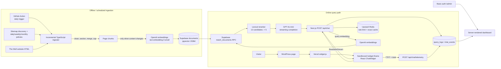

# WellChat technical interview dossier

Prepared September 6, 2026 from the local repository at commit `8ca522c`, its Git history, the current production deployment, non-sensitive Supabase aggregates, and the most recently modified resume found in Downloads (`gabriel-xiong-resume-1-sys.pdf`, modified September 3, 2026).

## How to use this dossier

Evidence labels:

- **Verified**: directly supported by code, Git history, build output, live HTTP behavior, or production aggregates.
- **Inferred**: a reasonable interpretation of verified evidence, but not directly documented.
- **Unverified**: plausible or resume-claimed, but the necessary evidence is missing.

Do not turn an inference into a personal story in an interview. The repository establishes what was built; it cannot fully establish who made product decisions, what stakeholders said, or what happened in unrecorded conversations.

## Evidence inventory and limits

| Source | What it establishes | Important limits |
|---|---|---|
| Current repository and 35-commit local Git history | Architecture, implementation, evolution from May 18 to July 21, 2026 | Commit authors use three variants of Gabriel's name/email; identity consistency is highly likely but not cryptographically proven |
| `README.md` and `project-spec.md` | Intended problem, scope, stack, build order, safety posture | Both contain drift from current code; the spec is an MVP plan, not proof of final behavior |
| Latest resume located in Downloads | Exact WellChat bullets: deployment, 88%→96% top-1 retrieval, 69.2% first-token improvement | The user did not explicitly nominate this resume; confirm it is the interview version |
| Retrieval and latency benchmark source | Metric definitions, evaluation questions, baselines, formulas, nominal sample sizes | No result artifact is committed. A rerun on September 6 failed because the local OpenAI credential was invalid |
| Production Vercel endpoints | `/`, `/widget`, and `/widget.js` return 200; `/admin` returns Basic-auth 401; configured security/cache headers are live | Does not prove every chat answer is correct or every external dependency is healthy |
| The Well homepage HTML | It currently includes `https://the-well-rag-agent.vercel.app/widget.js?v=2` | Does not reveal traffic, conversion, or staff approval history |
| Non-sensitive Supabase aggregate query | 70 chunks, 17 URLs, 347 query rows, indexing freshness, telemetry coverage | Query logs can include the developer, staff tests, and benchmarks; they are not unique users or adoption |
| `npm run lint` and `npm run build` on September 6 | ESLint passes and Next.js 16.2.6 production build succeeds | There are no automated test files, so this is not behavioral correctness evidence |

No separate project notes, diagrams, saved benchmark output, PR discussion, issue discussion, user-research record, cost report, or explicit team-ownership document was found. A PDF named `The Well Rag Project Spec.pdf` exists in Downloads, but the repository contains an apparently equivalent editable `project-spec.md`; the Markdown version was treated as canonical.

### Documentation drift to know before the interviewer finds it

- The README says pastoral and crisis queries bypass retrieval entirely. Only crisis matches always do; pastoral wording uses a fixed pastoral answer only when retrieval falls back.
- The project spec starts the threshold at 0.75; current code and environment example default to 0.25. Git history shows the change was made to improve service-time retrieval.
- The spec describes weekly refresh. The actual workflow triggers daily and runs ingestion when the newest stored document is at least five days old.
- The README points to `scripts/approved-pages.json`, while the current file and ingestion path are at the repository root.
- Repository docs show `widget.js?v=1`; the production church homepage currently requests `widget.js?v=2`.
- The README's “90-day” dashboard wording describes the query window, not deletion. The schema contains no automatic retention mechanism.

---

# 1. Executive understanding

## Problem and why it mattered

**Verified:** WellChat is a web assistant for The Well Austin Community Church. It helps visitors find practical information—service times, location, community groups, volunteering, giving, ministries, beliefs, events, staff, sermons, and related resources—without manually navigating a content-heavy site. It is deliberately scoped as a navigation and information assistant, not a pastor or counselor.

The problem matters because church visitors often arrive with high-intent, repetitive questions, while some queries can be sensitive. A useful solution therefore needs both retrieval quality and conservative failure behavior: cite approved pages when evidence exists, admit uncertainty when it does not, and route crisis or pastoral needs to people or emergency resources.

## Users and stakeholders

- **Verified users:** visitors to `thewellaustin.com`; the public site embeds the widget.
- **Verified operational stakeholder:** whoever has credentials to the protected `/admin` dashboard can review traffic, fallbacks, categories, sources, errors, rate limiting, cache use, and latency.
- **Inferred stakeholders:** church communications/web staff, pastoral staff, and site administrators.
- **Unverified:** the names of the sponsor, approver, or staff collaborators; the interviewee's relationship to the church; the exact approval process.

## Personal ownership versus teammates

**Verified:** all 35 commits in the local history are authored under variants of Gabriel Xiong's identity. The resume says, “Built and deployed.” This strongly supports end-to-end individual implementation ownership across schema, ingestion, API, UI, deployment integration, operations, and evaluation tooling.

**Do not claim yet:** that this was a solo project with no collaborators, that you personally chose every requirement, or that staff approved particular behavior. Say: “I implemented the repository end to end. I still need to verify how to describe stakeholder ownership and feedback because those conversations are not recorded in the repo.”

## Final outcome

**Verified:** a live, source-grounded RAG assistant deployed on Vercel and embedded on the church's production WordPress site through an isolated iframe loader. It includes:

- a 17-URL ingestion allowlist and 70 currently stored chunks;
- OpenAI `text-embedding-3-small` embeddings and Supabase pgvector cosine search;
- lexical reranking of 12 semantic candidates down to five chunks;
- GPT-4o mini answer generation streamed to a React chat interface;
- explicit fallback, crisis response, and prompt-level pastoral constraints;
- a Redis-backed 20-requests-per-10-minutes IP limit;
- seven-day caching for three exact suggested questions;
- scheduled re-ingestion checks;
- query, failure, cache, category, and browser latency telemetry;
- a Basic-auth-protected operations dashboard.

## Scale, constraints, timeline, and maturity

| Dimension | Evidence-backed description |
|---|---|
| Timeline | Initial spec committed May 18, core ingestion/API/UI by May 22, production hardening through July 21: about nine calendar weeks |
| Content scale | 17 approved URLs, 70 chunks as of September 4; 45 deep and 25 shallow chunks |
| Query evidence | 347 query-log rows from May 21 through September 6; 133 post-dashboard rows have categories and latency telemetry |
| Runtime scale | Serverless Next.js routes on Vercel, managed Postgres/pgvector, managed Redis, external OpenAI APIs |
| Constraints | Small curated corpus, WordPress host isolation, low operational overhead, safety-sensitive questions, changing event/site content, external API latency/cost |
| Maturity | Early production: genuinely live and instrumented, but without automated behavioral tests, saved eval artifacts, formal privacy retention, or robust ingestion transactions/retries |

Current production aggregates must be described carefully: 17 of 133 categorized queries fell back (12.8%), 25 hit the answer cache (18.8%), and browser-measured TTFT was p50 2.302 s / p95 5.635 s across 133 samples. These are operational observations, not controlled experiments, and the rows may include testing.

## Polished 30-second explanation

“I built WellChat, a RAG assistant that is live on The Well Austin's WordPress site. A TypeScript pipeline ingests only approved pages, chunks them by headings, embeds them with OpenAI, and stores them in Supabase pgvector. At query time I retrieve 12 semantic candidates, rerank them with lexical signals, give the best five to GPT-4o mini, and stream a source-linked answer. I also added crisis and fallback handling, Redis rate limits and caching, scheduled re-indexing, and a protected dashboard so the system is operable rather than just a demo.”

## Polished 90-second explanation

“The problem was that visitors had straightforward but scattered questions—when services happen, where to go, how to join a group, or how to volunteer—and the answers lived across many pages. I built WellChat as a narrow website assistant, not a general chatbot. The ingestion job fetches 17 explicitly approved URLs, extracts the main content, splits it around headings, merges tiny sections, caps long chunks, and prepends page-specific retrieval summaries before creating 1,536-dimensional embeddings. Those chunks live in Supabase Postgres with pgvector.

“For each question, the API rate-limits the client, handles explicit crisis language, embeds the query, retrieves the top 12 cosine matches, then adds a small lexical boost for matching terms in the URL, title, section, or content. The top five chunks go to GPT-4o mini with a strict grounding prompt, and the response streams into a React widget. The widget itself is hosted on Vercel and embedded into WordPress through a sandboxed iframe, so no secrets or AI logic enter WordPress.

“I added scheduled re-indexing, fallbacks, caching for common prompts, telemetry, and a protected analytics dashboard. The strongest evidence of production status is that the church homepage currently loads the widget, the database contains all 17 approved URLs, and the system has query and latency telemetry. The main caveat is that my resume's retrieval and latency numbers come from small custom harnesses whose historical output was not committed, so I would explain their methodology and limitations explicitly.”

## Detailed 3–5 minute walkthrough

“I started with a product constraint: this should help people navigate approved church information, but it should not improvise pastoral advice. That led to a curated RAG architecture rather than a general agent or live-web chatbot.

“Offline, a TypeScript ingestion process reads a 17-page allowlist. For each URL it fetches HTML, prefers the `<main>` element, removes scripts and styles, converts headings into boundaries, normalizes text, merges sections shorter than 300 characters, and splits long sections at roughly 1,800 characters. It adds a page-specific summary to make common intents—like Sunday service times—more lexically and semantically obvious. It batches a page's chunks through `text-embedding-3-small`, then replaces that page's prior rows in Supabase. A GitHub Action runs daily but only ingests when the latest stored index is at least five days old, or when manually triggered.

“Online, the React widget POSTs a question to a Next.js route. Redis executes a Lua `INCR`/`EXPIRE` script so the 20-request, 10-minute limit is atomic across serverless instances. Empty or over-1,000-character requests are rejected. Crisis phrases immediately return 911 and 988 guidance. For ordinary questions, exact matches to three suggested prompts can use a seven-day Redis cache.

“On a cache miss, the API embeds the question and calls a Supabase RPC. Postgres computes cosine similarity and returns up to 12 chunks above the configured threshold, currently defaulting to 0.25. Application code tokenizes the question and chunk metadata, adds 0.08 per matching question token in URL/title/section or 0.04 for a match in the first 500 content characters, sorts the candidates, and keeps five. Those chunks, including their URLs, sections, depth, and index time, become the only supplied context for GPT-4o mini at temperature 0.2.

“The server parses OpenAI's SSE stream and forwards text chunks through a web `ReadableStream`. The client updates one assistant message incrementally and records time-to-first-token and total response time. Query metadata and the completed answer go into Supabase. A protected server-rendered dashboard aggregates fallback rate, pastoral/crisis share, top sources, p95 TTFT, cache hits, API errors, and raw question drill-down.

“For WordPress, a tiny loader derives the trusted Vercel origin from its own script URL, creates a sandboxed iframe, and uses origin-checked `postMessage` events to resize between a small launcher and the full chat. Vercel's CSP restricts which parent sites can frame `/widget`.

“The design is appropriate for a small curated corpus and low-operations deployment. The weaknesses I would acknowledge are equally important: the ingestion replacement is not transactional, per-page failures are swallowed, safety keywords are brittle, pastoral queries do not actually bypass retrieval in all cases, raw crisis questions are logged despite the original redaction requirement, there are no automated tests, and the resume metrics need preserved result artifacts and stronger evaluation design.”

---

# 2. Resume-claim verification

## Claim 1: “Built and deployed a production RAG assistant for a live church website using Next.js, Vercel, and OpenAI embeddings”

**Operational meaning:** a publicly reachable application performs retrieval-augmented generation, is hosted on Vercel, and is integrated into the production church site.

**Support:** `package.json`, the App Router implementation, ingestion and database files, README demo URL, successful production build, live 200 responses from the Vercel app/widget/loader, and the production church homepage's `widget.js?v=2` script reference.

**What it proves:** the system is deployed and integrated, not merely a local prototype. The current database includes all 17 allowlisted URLs.

**What it does not prove:** traffic by unique real users, uptime, answer accuracy, staff satisfaction, a formal SLA, or that every request path is healthy.

**Likely challenge:** “What makes it production rather than a demo?”

**Defensible answer:** “It is embedded on the organization's live WordPress homepage, not only on my demo URL. I separated the host from the AI backend with a sandboxed iframe, added shared rate limiting, scheduled refresh, instrumentation, a protected operations dashboard, and server-only secrets. I use ‘production’ to mean live and operationally instrumented, not enterprise-grade—I would not claim an SLA or large-scale adoption.”

**Verdict:** supported, with the maturity caveat above.

## Claim 2: “Improved top-1 retrieval accuracy from 88% to 96% using Supabase pgvector, lexical re-ranking, and heading-aware chunking”

**Operational meaning:** on 25 hand-labeled questions, the expected page appeared at rank one for an implied 22/25 vector-only cases and 24/25 hybrid cases.

**Metric calculation:** `hits / 25 × 100`. A hit means the first returned chunk URL contains one of the manually listed expected slugs. Baseline is the first five candidates in Supabase cosine order. Hybrid reranks the same 12 candidates using cosine score plus lexical boosts, then takes five.

**Evaluation set:** 25 authored questions covering Sundays, community, serve, giving, ministries, beliefs, team, events, sermons, podcast, mission, stories, planting, missions, residency, and impact. Two questions allow either of two expected pages.

**Support:** `scripts/benchmark-retrieval.ts` fully defines the set, metric, and comparison. Git history shows the lexical reranker was introduced, reverted within four minutes, and reapplied six minutes later.

**Missing support:** no committed stdout, JSON/CSV result, date, document snapshot, or commit-pinned result proves the exact 88% and 96%. The September 6 rerun could not start because the local OpenAI key was invalid.

**What it does prove if the historical numbers are recovered:** the reranked system improved URL-level top-1 hit rate by 8 percentage points on that small set.

**What it does not prove:** answer factuality, end-to-end grounding, generalization to real user language, statistical significance, or independent contributions from heading-aware chunking. Both arms query the same production index, so the benchmark isolates reranking—not chunking. The set was authored and labeled by the developer and is not a held-out user sample.

**Likely challenges:**

- “Why call 25 questions enough?”
- “Is that 8% or 8 percentage points?”
- “How do you know chunking caused the gain?”
- “Were the questions created before or after tuning?”
- “Why URL match instead of relevance judgment?”

**Defensible answer:** “It was a 25-question regression set appropriate for rapid iteration on a 17-page corpus, not a statistically conclusive benchmark. The change is 8 percentage points, or two additional top-1 hits. The checked-in harness directly compares cosine ordering with lexical reranking on the same indexed chunks, so I can attribute that run to reranking but not separately to heading-aware chunking. To make the claim stronger, I would preserve the output, freeze the corpus, label a held-out set from real queries, and bootstrap confidence intervals.”

**Safer resume formulation until output is recovered:** “Built a 25-question retrieval evaluation harness and improved URL-level top-1 hit rate by 8 percentage points in a development run using lexical reranking; results should be rerun against a pinned corpus.”

**Verdict:** methodology verified; exact result insufficiently archived; causal wording over-attributes chunking.

## Claim 3: “Reduced first-token latency by 69.2% via GPT-4o mini streaming, with safety guardrails, IP rate limits, and automated re-indexing”

**Operational meaning:** the benchmark compared the wait for a complete non-streaming answer against time until the first streamed content for the same five questions, three trials each.

**Metric calculation:** `(mean non-streaming total time − mean streaming TTFT) / mean non-streaming total time × 100`. Both timings include embedding, Supabase retrieval/reranking, and model generation. Nominal sample size is 15 non-streaming plus 15 streaming calls. Each non-streaming trial runs before its streaming counterpart.

**Support:** `scripts/benchmark-latency.ts` defines the five questions, three-trial default, live calls, and formula. The production UI genuinely streams and collects browser TTFT. Production has 133 telemetry samples with p50 TTFT 2.302 s and p95 5.635 s, but those samples have no non-streaming control.

**Missing support:** the exact 69.2% output is not committed and could not be rerun with the invalid local key.

**What it proves if recovered:** users saw initial text much sooner than they would have seen a complete non-streamed answer in that small sequential experiment.

**What it does not prove:** reduced model execution time, reduced total response time, lower server cost, a production A/B result, or a stable 69.2% across network conditions. It compares two different endpoints of perceived wait: first token versus full completion.

**Guardrail nuance:** crisis phrases bypass retrieval and return a fixed answer. Pastoral phrases only force a pastoral response when retrieval otherwise falls back; a sufficiently similar pastoral query still reaches the model with prompt-level constraints. The README's broader “bypass retrieval entirely” description is not true for all pastoral queries. Also, crisis question text is logged, contrary to the original spec's redaction note.

**Likely challenge:** “Did streaming make the backend 69% faster?”

**Defensible answer:** “No. It improved perceived responsiveness: I compared time to first visible streamed text with the time a user would wait for a complete non-streaming answer. The benchmark used five representative questions with three trials each and included retrieval and network time. Total streaming completion can be similar or longer. I should describe this as time-to-visible-feedback, not backend speed.”

**Safer resume formulation:** “Reduced measured time to visible feedback by 69.2% versus waiting for complete non-streaming responses in a 15-trial development benchmark; added crisis routing, Redis IP limits, and scheduled re-indexing.”

**Verdict:** feature set verified; exact percentage insufficiently archived; current phrasing is vulnerable because “first-token latency” suggests like-for-like latency reduction.

## Production aggregate claims you may use verbally

As of September 6, 2026:

- 70 chunks across 17 approved pages; indexed September 4.
- 347 query-log rows since May 21. Do not call these 347 users.
- 133 categorized/telemetry-complete rows since July 18.
- Among those 133: 12.8% fallback rate and 18.8% exact-answer cache-hit rate.
- Browser TTFT across those 133: p50 2.302 s, p95 5.635 s; total response p50 3.625 s, p95 6.901 s.
- `chat_events` currently contains zero recorded API-error or rate-limit events. Say “zero recorded events,” not “zero errors.” Logging itself can fail and the table postdates initial launch.

---

# 3. System architecture

## Component responsibilities and contracts

| Component | Responsibility | Contract |
|---|---|---|
| `approved-pages.json` | Corpus allowlist and deep/shallow metadata | Array of `{url, depth}` where depth is `deep` or `shallow` |
| `scripts/ingest.ts` | Fetch, clean, chunk, embed, replace | Writes rows with URL/title/section/content/depth/type/1536d embedding/index time |
| `documents` + `match_documents` | Persistent corpus and cosine retrieval | RPC accepts vector, threshold, limit; returns document fields plus similarity |
| `lib/retrieval.ts` | Deterministic lexical reranking | Input question + candidates; output new sorted array, default max five |
| `POST /api/chat` | Validation, safety, cache, retrieval, generation, streaming, logging | Input JSON `{question}`; output JSON for fixed/fallback paths or `text/plain` stream; query ID in body/header |
| Upstash Redis | Atomic fixed-window counters and exact suggested-answer cache | REST command endpoint authenticated server-side |
| `ChatWidget.tsx` | Conversation UI, stream consumption, suggestions, telemetry | Uses content type to distinguish JSON from streaming response |
| `public/widget.js` | Cross-site mounting and responsive iframe sizing | `postMessage` messages include source, type, and open/compact state; both sides validate origin/source |
| `POST /api/chat/telemetry` | Attach browser latency to an asynchronously created query row | UUIDv4 + integer TTFT/total in [0, 300,000]; retries DB update at 0/150/500/1000 ms |
| `/admin` + `proxy.ts` | Protected operational reporting | HTTP Basic auth; server-side service-role reads only |

## Main user-action flow

1. WordPress loads `widget.js` from the Vercel origin.
2. The loader derives that origin from `document.currentScript`, creates one iframe, and supplies `site`, `parentOrigin`, and compact mode query parameters.
3. The iframe sends origin-scoped resize messages; the parent toggles between collapsed and open dimensions.
4. The visitor submits a question. The UI immediately appends the user message and POSTs JSON.
5. The server rate-limits by the first `x-forwarded-for` address, then validates the body and length.
6. Crisis keyword matches return fixed JSON. Other requests require all Supabase, OpenAI, and Redis configuration.
7. Three exact suggested questions may hit Redis. Cache hits are replayed one word every 45 ms as a text stream.
8. A cache miss is embedded, retrieved from Supabase, reranked, and either falls back or streams a GPT answer.
9. The client creates the assistant message on first content and mutates it as chunks arrive.
10. The server logs the completed query; the client separately posts TTFT and total time using the query UUID.

## Authentication, authorization, validation, and security

- OpenAI, Supabase service-role, Redis, and dashboard credentials are server environment variables.
- Database RLS is enabled; `anon` and `authenticated` table access and RPC execution are revoked. Server code uses the service role.
- `/admin` is protected by HTTP Basic auth. Username and password digests are compared without early byte exit, reducing timing leakage after SHA-256.
- `/widget` CSP restricts framing to self, two production hostnames, and one staging hostname. Camera, microphone, and geolocation are disabled.
- The iframe sandbox allows forms, scripts, same-origin, and popups. Cross-window messages validate both origin and window source.
- Questions are required, trimmed, and capped at 1,000 characters. Telemetry requires a UUIDv4 and bounded nonnegative integers.
- Weaknesses: `x-forwarded-for` trust is deployment-dependent; there is no CSRF/origin check on public chat or telemetry routes; no output-source URL allowlist is enforced; guardrails are substring lists; raw sensitive text is retained.

## State and persistence

- Conversation state exists only in React memory and is lost on refresh or close; there is no user identity or conversation table.
- Corpus, query logs, events, and telemetry persist in Supabase.
- Rate counters and three exact cached answers persist in Redis.
- A module-level Supabase client may be reused inside a warm serverless instance.
- The admin page queries a rolling 90-day window, but that is a view/query limit—not a retention policy. Rows are not automatically deleted.

## Concurrency, async work, caching, retries, and recovery

- Redis Lua makes increment/expiry atomic across concurrent serverless requests.
- Query logging after rate limits and API failures uses Next.js `after()`.
- Streaming answer finalization runs logging and cache write concurrently with `Promise.allSettled`.
- Admin loads query and event tables concurrently.
- Telemetry retries only the query-row update to handle the race between client telemetry and server logging.
- There are no general retries/backoff/timeouts for site fetch, OpenAI, Redis, or Supabase.
- Ingestion is sequential by page and catches each page error, so one failed page does not stop others—but the workflow can still report success after partial failure.
- Replacement is delete then insert without a transaction. If insertion fails, that page temporarily disappears.
- Cache keys are exact normalized strings and TTL is seven days. They are not invalidated on re-ingestion, so cached service/belief/group answers can outlive the corpus version.

## Deployment, monitoring, testing, and debugging

- Vercel hosts static pages, dynamic API routes, dynamic widget page, and dynamic admin page.
- GitHub Actions checks daily and ingests when the newest document row is at least five days old. This is not exactly “weekly.”
- WordPress runs no retrieval logic and stores no secrets; it only includes the Vercel loader.
- Query logs record selected chunk IDs/URLs/titles/similarities, answer, fallback, category, cache status, and timestamps.
- Browser telemetry adds TTFT and total response time. `chat_events` records only rate-limit and API-error events.
- Retrieval and latency scripts are development benchmarks, not CI tests.
- There are no unit, integration, end-to-end, load, safety-regression, or ingestion-fixture tests.
- Verified September 6: lint passes and production build succeeds.

## Spoken architecture walkthrough

“I separate the system into offline corpus preparation, online retrieval/generation, and host integration. Offline, a scheduled TypeScript job turns 17 approved website pages into heading-aware chunks and stores 1,536-dimensional embeddings in pgvector. Online, a Next.js route applies a shared Redis rate limit, routes explicit crisis language, optionally serves an exact cache hit, embeds the query, gets 12 cosine candidates, lexically reranks to five, and streams a grounded GPT-4o mini answer. Supabase stores both the corpus and telemetry. The React UI is isolated from WordPress in a CSP-restricted sandboxed iframe, and an origin-checked message protocol resizes it. Operations are visible through a service-role, server-rendered dashboard protected by Basic auth.”

---

# 4. Code-level deep dive

## `scripts/ingest.ts`

**Purpose:** transform allowlisted website HTML into retrievable vector rows.

**Inputs:** environment configuration and `{url, depth}` entries. **Outputs:** one or more `documents` rows per URL. **Invariant:** every stored embedding should correspond by array index to its chunk and have 1,536 dimensions; code relies on the API/schema rather than checking either condition.

**Step-by-step:** normalize URL → fetch → choose `<main>` or strip large layout blocks → remove script/style → mark headings → strip tags/decode a limited entity set → normalize known noise → split headings → merge sub-300-character sections forward → split roughly above 1,800 characters → prepend page-specific summary → embed a page's chunks in one request → delete old URL rows → insert new rows.

**Complexity:** cleaning/splitting is approximately O(H) in HTML length. `chunkLongText` repeatedly calls `currentWords.join(' ')` inside the word loop, making its worst-case character work closer to O(W²) for a large section; bounded site pages make this tolerable. Network and embedding latency dominate.

**Edge/failure modes:** regex HTML parsing, JS-rendered content, nested heading tags, incomplete named-entity decoding, oversized embedding batch, mapping mismatch, fetch failure, partial ingestion, deletion/insert gap, stale hard-coded Sunday summary, and overly broad event-date regex.

**Testing:** no automated tests. The script logs stored counts. A robust suite would use frozen HTML fixtures, snapshot expected chunks, assert embedding-to-chunk alignment with a fake API, and transactionally test replacement.

## `db/schema.sql` and `match_documents`

**Purpose:** persist corpus/telemetry and expose vector retrieval.

`documents.embedding` is `vector(1536)` and uses cosine distance `<=>`; similarity is `1 - distance`. The RPC filters by threshold, orders ascending distance, and limits results. An IVFFlat index uses 100 lists.

**Invariants:** non-null content, embedding, and index time; depth constrained to deep/shallow. There is no uniqueness constraint preventing duplicate URL/chunk content.

**Complexity:** approximate nearest-neighbor search is sublinear in favorable indexed conditions, but exact behavior depends on pgvector planner/index training/probes. With only 70 rows, index tuning is not the bottleneck and exact scan could be simpler.

**Weaknesses:** no migrations framework, no transactional ingestion RPC, no retention job, no explicit grants for the service role in this script, and no DB-level category constraint.

## `lib/retrieval.ts`

**Purpose:** combine semantic ordering with cheap deterministic lexical signals.

The tokenizer lowercases, strips URL schemes/non-alphanumeric characters, discards tokens of length ≤2 and a small stop list. For every question token, the boost is 0.08 if it appears in URL/title/section, otherwise 0.04 if it appears in the first 500 content characters. The function sorts a copy and returns five.

**Complexity:** for K candidates, tokenization is O(total text), set lookups are expected O(1), and sorting is O(K log K). K is capped at 12, so cost is negligible.

**Failure modes:** repeated or correlated tokens can overboost; no normalization by question length; substring tokenization is English-only; the first 500 characters may omit decisive terms; weights are hand-tuned; and returned `similarity` remains the raw cosine score, not the combined rank score, complicating observability.

## `app/api/chat/route.ts`

**Purpose:** orchestrate the public request lifecycle.

**Important invariant:** model context should contain only retrieved approved chunks. The prompt states this, but there is no post-generation factuality/citation validator.

**Happy path:** fixed-window rate check → validation → UUID/category → cache lookup → query embedding → RPC candidates → rerank → context formatting → OpenAI streaming → stream forwarding → query logging/cache write.

**Complexity:** local work is tiny; total time is external embedding + DB + model latency. Prompt size is bounded indirectly by five chunks of roughly 1,800+summary characters.

**Failure modes/debt:** one large route owns too many responsibilities; Redis failure makes all nonempty requests fail and occurs even before crisis routing; OpenAI SSE JSON parsing assumes well-formed lines; midstream errors yield truncated UI behavior; no abort propagation; no request timeout; user/source prompt injection is not delimited as untrusted data beyond labels; pastoral routing is incomplete; source links are generated by the model rather than verified against retrieved URLs; logs retain raw sensitive text.

## `components/ChatWidget.tsx`

**Purpose:** provide conversation UI in both standalone and embedded modes.

**State:** open/closed, in-memory messages, current question, loading/error state, used suggestions, compact launcher. Refs hold message sequence and current streamed answer without triggering unrelated renders.

**Stream flow:** `fetch` → check content type → JSON fixed response or `response.body.getReader()` → decode each network chunk → append to ref → create assistant message at first chunk → replace its content on later chunks → submit telemetry.

**Failure modes/debt:** no auto-scroll anchor, persistence, cancellation, retry button, accessible live region, per-message error, or source verification; every network chunk can cause a full message-array map/render; conversation history is not sent to the server, so follow-up questions lack context. The `sources` field is effectively unused on streaming responses because links are embedded in Markdown.

## `public/widget.js` and `/widget`

**Purpose:** embed the React UI without CSS or dependency conflicts on WordPress.

The loader is idempotent by iframe ID, derives its backend origin from its own URL, sets maximum z-index-like positioning, uses a sandbox, and exchanges origin-checked resize/viewport messages. Desktop open size caps at 460×720; mobile uses full viewport and `100dvh`.

**Failure modes:** no teardown API, resize listener persists for page lifetime, no version handshake, `parentOrigin` is client-provided although cross-checking limits misuse, and `allow-same-origin` + `allow-scripts` weakens sandbox isolation relative to an opaque origin—but is practical for a same-origin hosted app.

## Redis rate limiting and caching

The Lua script atomically increments a per-IP key and sets expiry only on the first request. This is a fixed window: request bursts can straddle boundaries. Unknown IPs share one bucket. Cached answers exist only for three exact suggestion strings and are replayed one word every 45 ms, which keeps the visual streaming effect but intentionally adds latency.

## Telemetry and dashboard

The browser measures from submit to first received content and completion. The telemetry route retries the update because the query log may be written just after streaming ends. The dashboard calculates p95 with the nearest-rank method, aggregates client-side over up to 2,000 rows in a server-fetched 90-day window, and exposes raw questions/answers to authenticated operators.

Weaknesses include spoofable client latency, update authorization based only on hard-to-guess query UUID, row caps that silently truncate aggregates, lack of pagination, and no deletion policy.

## Three whiteboard code paths

### A. Ingestion and safe replacement

Draw: allowlist → HTML extraction → semantic sections → bounded chunks → batch embeddings → old-row delete → insert.

Explain why headings preserve topic coherence better than blind windows for a small website. Then immediately surface the tradeoff: replacement prevents stale orphan chunks, but delete/insert is not atomic. The production redesign is an ingestion run ID or staging table followed by a transaction that swaps versions only after all new rows validate.

### B. Hybrid retrieval and grounded streaming

Draw: question → embedding → top 12 cosine candidates → metadata/content token sets → combined score → top 5 → prompt → SSE → browser stream.

Be able to derive cosine similarity conceptually: direction captures semantic alignment; `1 - cosine distance` gives a higher-is-better score. Explain lexical reranking as a precision correction for proper nouns and navigational terms. State that the current benchmark isolates reranking only, and that combined scores are not logged.

### C. Cross-origin iframe integration

Draw: WordPress script → Vercel iframe → `postMessage` resize in both directions. Label three trust controls: iframe origin derived from loader URL, event origin/source verification on both sides, and CSP `frame-ancestors`. Explain why an iframe was chosen: style isolation, backend independence, secret isolation, and a small WordPress footprint.

---

# 5. Technical decisions and tradeoffs

| Decision | Why it fit | Gain | Sacrifice / breaking point | Rebuild choice |
|---|---|---|---|---|
| Curated RAG instead of a general bot | Small authoritative site and hallucination-sensitive content | Grounding, controllable scope | Cannot answer outside corpus; model can still disobey | Keep RAG; add citation entailment and retrieval confidence evaluation |
| Next.js full stack on Vercel | One TypeScript codebase and simple deployment | Low ops, colocated UI/API | Vendor/runtime coupling, serverless external latency | Keep at this scale; split workers only for heavier ingestion |
| Supabase Postgres + pgvector | Small corpus plus relational telemetry | One managed data plane, SQL visibility | Approximate-index tuning and service-role dependence | Keep; use exact scan at tiny scale or HNSW when corpus grows |
| `text-embedding-3-small` 1536d | Economical general embedding model | Low cost and straightforward pgvector support | External API and fixed schema dimension | Keep pending benchmark against newer/smaller alternatives |
| Heading-aware chunks | Site sections align with user intents | Better coherence and citations | Regex/markup dependence; uneven chunks | Use a real DOM parser and token-aware boundaries with overlap |
| URL-specific summary injection | Fixed known intents were missed by raw copy | Fast retrieval correction | Hard-coded facts can stale or leak into every chunk | Store reviewed metadata separately; never hard-code changing service facts |
| Retrieve 12, rerank to 5 | Small candidate pool for cheap precision improvement | Low latency and prompt size | Recall ceiling if correct page is outside 12 | Tune K using held-out recall and add BM25/full-text search |
| Hand-weighted lexical boost | Easy to reason about and deploy | Deterministic proper-noun/navigation correction | Brittle weights, no learned calibration | Use reciprocal-rank fusion of vector and PostgreSQL FTS, then evaluate |
| Threshold 0.25 | Avoid empty retrieval after 0.75 proved too strict in history | More answer coverage | More weak context/hallucination risk | Calibrate threshold on labeled relevant/irrelevant pairs |
| Streaming | Perceived responsiveness | Early visible feedback | More complex parsing/errors; total time not reduced | Keep; use an SDK/Responses stream parser and cancellation |
| Exact cache for suggestions | High reuse with no semantic-cache false positives | Cost/latency savings | Only three prompts; seven-day staleness | Version keys by corpus index and return cached text immediately or in larger chunks |
| IP fixed-window limit | Shared protection across serverless instances | Simple atomic abuse control | NAT collisions and boundary bursts | Sliding-window/token-bucket plus trusted Vercel IP extraction |
| Keyword crisis routing | Deterministic fast emergency response | Avoids model improvisation | False negatives/positives, English-only | Put crisis check before Redis; add tested classifier plus conservative keyword layer |
| Prompt-only shallow-page behavior | Minimal implementation | Easy product control | Not technically enforced | Enforce shallow behavior in response construction/tool contract |
| Delete then reinsert | Removes stale chunks after page changes | Simple correctness model | Non-atomic empty-page failure | Versioned transactional swap |
| Iframe embed | WordPress/CSS isolation | Tiny host integration and no exposed secrets | Messaging/responsive complexity | Keep; package a formal versioned embed API |
| Basic-auth admin | Fast restricted access for few operators | Very small implementation | Shared credentials, no audit/revocation/MFA | Use an identity provider if more than a tiny trusted staff group |
| Raw query logging | Debugging and product insight | Direct failure analysis | Sensitive-data/privacy risk | Consent notice, redaction, least retention, role-based access |

At 10× the current corpus, this architecture likely still works. At 100×–1,000× documents or high request volume, revisit ANN indexing, retrieval fusion, embedding batching/queues, rate-limit policy, serverless connection behavior, cache strategy, dashboard pagination, and observability. The dominant scaling constraints are external API latency/cost and operational correctness, not the O(12 log 12) reranker.

---

# 6. ML and data methodology

## What is and is not ML training

There is no model training or fine-tuning in this project. WellChat uses pretrained embedding and generative models at inference time. The project's ML work is corpus construction, retrieval design, prompt constraints, and evaluation.

## Corpus construction

- **Source:** 17 public, explicitly approved pages from one church website.
- **Current size:** 70 chunks; 45 marked deep, 25 shallow.
- **Preprocessing:** main-content extraction, limited entity decoding, whitespace/noise cleanup, heading segmentation, merge under 300 characters, split around 1,800 characters, URL-specific summary injection, special event formatting.
- **Quality control:** allowlist and logged chunk counts. No committed manual chunk-review checklist or frozen corpus snapshot.
- **Splits:** none. The live corpus is both development target and evaluation substrate.

## Labels, bias, and leakage

The retrieval set has 25 developer-authored questions and expected URL slugs. There is no evidence of independent labeling, inter-rater agreement, a held-out test set, or pre-registration. Because the same developer designed summaries, boost weights, questions, and labels, tuning leakage is likely. The questions are clean and canonical; real visitors may use typos, multi-intent questions, local terminology, or sensitive phrasing.

## Retrieval model and inference

`text-embedding-3-small` maps both chunks and questions into 1,536-dimensional vectors. Cosine similarity compares direction rather than magnitude. pgvector produces semantic candidates; lexical boosts then favor exact terms in high-signal metadata. GPT-4o mini receives the top five chunks and generates at temperature 0.2.

## Evaluation metrics

- **Top-K URL hit rate:** whether an expected page appears in first K retrieved chunks. Appropriate for navigation retrieval, but coarse: it does not judge chunk relevance or answer support.
- **TTFT:** browser/server benchmark time until first content. Appropriate for perceived responsiveness.
- **Total response time:** time until stream completion.
- **Fallback/cache rates:** useful operations signals, not model-quality metrics.

Missing end-to-end metrics include answer correctness, citation precision/recall, faithfulness, unsupported-claim rate, safety recall, user task success, and human satisfaction.

## Baselines and ablations

Verified baseline: pgvector cosine order versus reranking the same candidate set. No clean ablation exists for heading chunking, summary injection, candidate K, threshold, lexical field/weight, prompt, or model. No statistical test or confidence interval is computed.

For a 24/25 proportion, uncertainty is large despite the impressive percentage. A single question changes accuracy by four percentage points. The right interview posture is to emphasize a regression harness and directional improvement, not broad generalization.

## Error analysis and likely failures

- Correct URL outside top 12 cannot be recovered by reranking.
- Metadata term overlap can promote a semantically weak chunk.
- Similar pages—mission, missions, planting, residency—can collide.
- Hard-coded summaries can dominate embeddings and stale.
- Dynamic/JS-rendered or irregular HTML can be absent or malformed.
- Multi-turn references like “What about parking?” lack conversation context.
- Model may cite an unprovided or malformed URL because citations are not validated.
- Keyword safety misses euphemisms, misspellings, other languages, negation, and context.
- Event information can become stale between approximately five-day refreshes.

## Reproducibility, latency, throughput, compute, and cost

- Dependencies are lockfile-pinned, code and eval questions are committed, and the corpus allowlist is explicit.
- Reproducibility is incomplete because model versions are provider aliases, the website changes, database snapshots/results are absent, and secrets/configuration are external.
- Ingestion embeds chunks in a batch per page and processes pages sequentially.
- Online queries make an embedding call, a DB RPC, and usually a chat call. There is no concurrency within this dependency chain.
- Exact cache hits avoid embedding, retrieval, and LLM cost for three prompts.
- No token, request-cost, or throughput records were found.

## Safety and reliability distinction

Retrieval performance is not product performance. A correct top-ranked page can still yield an unsupported answer; a lower-ranked correct chunk may still be enough; a fast first token can begin a wrong answer; a perfect crisis classifier does not ensure an appropriate overall UX. End-to-end evaluation must test the actual answer, citations, fallback decision, safety route, latency, and user task completion together.

## Concepts to explain without buzzwords

- **Embedding:** a numeric representation where texts with similar meaning tend to point in similar directions.
- **Cosine similarity:** compares vector direction, making it useful when meaning matters more than vector size.
- **RAG:** fetch evidence first, then ask the language model to answer using that evidence; it reduces but does not eliminate hallucination.
- **Reranking:** use a cheap broad retriever for recall, then reorder a small candidate set using extra signals for precision.
- **Grounding:** every material claim should be supported by supplied source content.
- **TTFT:** how long the user sees a loading state before any answer text appears; it differs from full completion time.

---

# 7. Product and business reasoning

## Why solve it

The assistant reduces navigation friction for repetitive, high-intent questions while preserving a path to official content. For a small organization, a narrow assistant can extend website usability without staffing live chat.

## Requirements and success criteria

Verified requirements were: approved content only, sources with answers, graceful unknown fallback, shallow-page linking, factual belief answers without spiritual advice, crisis/pastoral escalation, no invented operational facts, hosted demo followed by WordPress integration.

The implementation adds measurable operational criteria: retrieval hit rate, fallback rate, p95 TTFT, API-error/rate-limit events, cache hits, and top retrieved pages. There is no documented launch target for any of them.

## Scope prioritization

The Git history matches the spec's staged sequence: schema → ingestion → chat/UI → retrieval correction → streaming → expanded pages → rate limiting/evals → scheduled ingestion → WordPress → caching/dashboard/mobile polish. This is a strong example of vertical-slice prioritization.

Deliberately excluded or absent: general web search, sermon-level semantic search, accounts, conversation persistence, live page fetching per query, admin-triggered reindex, personalization, and theological/pastoral advice.

## Demonstrated versus projected impact

**Demonstrated:** live site embed, indexed corpus, 347 query rows, operational telemetry, cache use, fallbacks, and reproducible architecture/build.

**Not demonstrated:** unique visitors, deflected staff contacts, improved conversion, reduced support hours, staff satisfaction, user task success, or retention. Do not convert query count into business impact.

## Costs and operations

Variable costs come from query embeddings, GPT tokens, Supabase, Redis, and Vercel. Cache saves the full online AI path for exact prompts. Ingestion cost is small at 70 chunks but refreshes every page even if unchanged. The project lacks cost instrumentation, change detection, and token accounting.

## What to measure after launch

1. Human-rated answer correctness and citation support on sampled queries.
2. Task completion or source-link click-through by intent.
3. Fallback precision/recall and unresolved question themes.
4. Crisis/pastoral route recall using a privacy-safe synthetic suite.
5. p50/p95 TTFT and total time split by cache/retrieval/model stage.
6. Cost per answered query and cache savings.
7. Repeat errors after content refresh and index staleness.
8. Unique sessions only with a clear privacy basis and minimal retention.

## Highest-impact next feature

Build a privacy-safe evaluation and review loop before adding breadth. Version the corpus, sample/redact production failures, label retrieval and answer support, run the suite in CI, and surface regressions in the dashboard. This improves trust, makes resume claims defensible, and guides whether the next product feature should be conversation context, better search, or content changes.

---

# 8. Challenges and behavioral stories

These outlines use repository evidence. Replace bracketed unknowns with your real memory; do not invent stakeholder reactions.

## Ambiguity / scoping a sensitive assistant

- **Situation:** Visitors needed practical answers, but the domain included beliefs, counseling, and crisis language.
- **Task:** Define a useful MVP without presenting an AI system as pastoral authority.
- **Action:** Limited ingestion to approved pages; encoded deep/shallow scope; required citations and fallbacks; added crisis and pastoral language handling; kept WordPress as a display host only.
- **Result:** A live assistant with explicit scope and escalation behavior.
- **Verify:** who helped define the boundary and who approved it.

## Ownership / end-to-end delivery

- **Situation:** The project began as a written spec with no application.
- **Task:** Deliver an integrated, operable product.
- **Action:** Implemented schema, ingestion, retrieval, streaming UI/API, embed loader, rate limiting, reindexing, caching, telemetry, dashboard, and mobile polish over 35 commits.
- **Result:** Live production embed and instrumented corpus/query system.
- **Verify:** whether any code, design, deployment, or content work came from others.

## Incorrect assumption / service-time retrieval

- **Situation:** The initial 0.75 similarity default did not reliably retrieve service-time content.
- **Task:** Improve coverage without hard-wiring every query to one page.
- **Action:** Git history first shows threshold reduction and a special Sundays lookup, then a lexical+semantic approach. The final architecture retrieves a broader 12 and reranks using metadata/content overlap, while ingestion summaries emphasize the intent.
- **Result:** A more general hybrid retrieval path and an evaluation harness.
- **Be candid:** the final causal metric cannot isolate the summary, chunking, and reranking changes.

## Revert and reapply / technical disagreement or self-correction

- **Situation:** Lexical reranking was introduced, reverted four minutes later, then reapplied six minutes later.
- **Task:** Resolve a risky retrieval change quickly.
- **Action:** Describe only what you actually remember—e.g., a regression, deployment concern, or need to inspect the diff. Git proves the sequence but not the reason.
- **Result:** Reranking remained in the product and was later extracted into a library with a benchmark.
- **Verify:** why the revert occurred. This can be a good debugging story only if you remember the evidence.

## Time pressure / milestone delivery

- **Situation:** Core ingestion, API, and UI landed within four days of the initial spec.
- **Task:** Prove the vertical slice quickly.
- **Action:** Followed milestone boundaries, used one Next.js codebase and managed services, deferred WordPress integration and operational hardening until the core flow worked.
- **Result:** Core system by May 22; hardening followed rather than blocking the proof of concept.
- **Verify:** whether there was an external deadline.

## Difficult integration / WordPress iframe

- **Situation:** A Vercel React assistant had to coexist with a production WordPress theme across desktop and mobile.
- **Task:** Avoid style collisions and keep secrets/backend logic out of WordPress.
- **Action:** Built a tiny loader, sandboxed iframe, CSP parent allowlist, origin-checked messaging, responsive frame sizing, staging preview, and plugin fallback.
- **Result:** The production homepage loads the Vercel widget; later commits specifically fix display and mobile behavior.

## Feedback and iteration

- **Situation:** After initial deployment, the UI and operational visibility needed refinement.
- **Action:** Added typography/mobile polish, rotating suggestions, avatar behavior, cache, analytics, and latency telemetry.
- **Result:** A more usable and observable product.
- **Verify:** which changes came from staff/user feedback versus your own review.

## Tradeoff / raw telemetry

- **Situation:** Retrieval failures and sensitive user needs are hard to improve without real examples.
- **Action:** Logged questions, sources, scores, answers, and categories behind an authenticated dashboard.
- **Result:** Direct operational visibility.
- **Lesson:** the implementation has a privacy debt: raw sensitive text, no true 90-day deletion, and a spec/code mismatch on redaction. A strong behavioral answer owns this and explains the redesign.

---

# 9. Interview question bank

## 15 foundational questions

1. **What did you build?** A production-embedded RAG assistant for a church website, with curated ingestion, hybrid retrieval, streamed grounded answers, safety/fallback routing, and operations tooling.
2. **What user problem did it solve?** It shortened the path from common visitor questions to authoritative site content without requiring users to know the site's navigation.
3. **Why RAG?** The facts already lived in approved pages and changed over time. Retrieval lets the model answer from current authorized evidence rather than memorized or improvised knowledge.
4. **What does “grounded” mean here?** The prompt receives only retrieved chunks and asks for source links. It is an intended constraint, not a formal guarantee because output is not post-validated.
5. **What is the stack?** Next.js/React on Vercel, Supabase Postgres with pgvector, OpenAI embeddings and GPT-4o mini, Upstash-compatible Redis, GitHub Actions, and a WordPress iframe integration.
6. **How large is the corpus?** Currently 17 approved URLs and 70 chunks—small enough that simplicity and content quality matter more than distributed scale.
7. **What happens when I ask a question?** Rate limit, validate, safety route/cache, embed, retrieve 12, rerank to five, stream model output, then log and record browser latency.
8. **What did you personally own?** The Git history and resume support end-to-end repository implementation. Clarify stakeholder/product collaboration separately.
9. **Why not let the model search the web live?** The product required approved church content, predictable latency, and a defensible source boundary.
10. **How is it on WordPress?** A small script inserts a sandboxed Vercel iframe; WordPress has no AI keys or retrieval code.
11. **How do you handle unknowns?** An RPC threshold filters weak candidates; empty/weak retrieval produces a fixed contact fallback.
12. **How do you handle crises?** Explicit self-harm phrases return fixed 911/988 guidance before retrieval/generation, although rate limiting currently happens first.
13. **How fresh is content?** A daily Action checks the latest index and refreshes when it is at least five days old; manual dispatch is supported.
14. **How do you know it is live?** The Vercel pages respond, the admin route is protected, and the production church homepage includes the widget loader.
15. **What is the project's maturity?** Early production: live, protected, rate-limited, scheduled, and instrumented, but lacking automated correctness tests, formal privacy retention, and archived eval results.

## 20 technical deep-dive questions

1. **How are chunks created?** Heading boundaries first, forward-merge sections under 300 characters, then word-split sections around 1,800 characters. Page-specific summaries are prepended.
2. **Why headings over fixed token windows?** Website headings represent semantic sections and yield understandable citations. The drawback is dependence on clean markup and uneven sizes.
3. **Why 1,800 characters rather than tokens?** It is a simple corpus-specific bound; it is not model-aware. A rebuild should use tokenizer-aware limits and measured overlap.
4. **How does the vector SQL work?** It computes `1 - (embedding <=> query_embedding)`, filters by threshold, orders by cosine distance, and limits candidates.
5. **What exactly is hybrid about retrieval?** Candidate generation is semantic; application reranking adds exact token overlap in URL/title/section/content. It is not a full BM25/vector fusion system.
6. **Why boost metadata more than content?** Page paths and headings are compact intent signals, so 0.08 versus 0.04 prioritizes navigational matches. The weights are heuristic and need ablation.
7. **Why retrieve 12 and pass five?** Twelve gives reranking room while five limits prompt size and noise. K was not rigorously tuned.
8. **What is reranker complexity?** O(text tokenization + K log K), with K=12, so external calls dominate.
9. **How do you prevent stale chunks?** Replace all rows for a URL. The current delete/insert gap is non-transactional and should become a versioned atomic swap.
10. **What happens on one-page ingestion failure?** It logs and continues, which preserves other pages but can make the workflow falsely green and leave that page stale.
11. **How is rate limiting shared across Vercel instances?** Redis stores the per-IP counter; Lua makes increment plus first-expiry atomic.
12. **What rate-limit algorithm is it?** Fixed window, 20 requests per 600 seconds. Boundary bursts and shared NAT addresses are weaknesses.
13. **How does streaming work end to end?** OpenAI SSE is parsed on the server, content is enqueued into a web stream, and the browser's reader updates one React message incrementally.
14. **How do you correlate latency with a query?** The server generates a UUID, returns it in a header/body, logs the query, and the browser posts measurements; the telemetry route retries to resolve races.
15. **Why can telemetry race?** The browser can finish receiving just as server finalization is still inserting the row.
16. **How does the cache work?** Only three exact, lowercased suggestion strings map to stable Redis keys with seven-day TTL. It is not semantic caching.
17. **How is the admin route secured?** Next proxy enforces Basic auth with digest comparisons; server rendering uses the Supabase service role and no database credentials reach the browser.
18. **What prevents iframe message spoofing?** Both parent and child check `event.origin` and `event.source`, and messages carry a fixed source/type marker.
19. **What gets logged?** Question, retrieved IDs/URLs/titles/raw similarities, answer, fallback, category, cache status, and latency; rate/error events go to a separate table.
20. **How would you test it?** Unit-test cleaning/chunking/reranking/classification, integration-test RPC and stream handling with fakes, fixture-test ingestion, E2E-test iframe/mobile behavior, and run frozen retrieval/safety/faithfulness suites in CI.

## 10 design and tradeoff questions

1. **Why Supabase rather than a dedicated vector DB?** At 70 chunks, Postgres is operationally simpler and also stores telemetry. A dedicated system adds little until scale or retrieval features justify it.
2. **Why GPT-4o mini?** It fits a narrow, context-grounded, latency/cost-sensitive task. The choice should still be reevaluated with an end-to-end eval rather than brand preference.
3. **Why not return retrieved text directly?** Generation synthesizes across chunks and gives a conversational answer, but adds hallucination/cost risk. For deterministic fields like service times, structured rendering could be safer.
4. **Why not fine-tune?** The challenge is changing factual knowledge and retrieval, not teaching a new capability. Fine-tuning would not solve freshness or citation provenance.
5. **Why not query the website live?** Offline indexing improves response latency and controls content, at the cost of up-to-five-day staleness.
6. **Why an iframe rather than a web component?** Strong CSS/runtime isolation and a tiny WordPress integration. The cost is cross-window sizing and messaging complexity.
7. **Why cache only suggestions?** Exact keys avoid semantic-cache correctness risk and target high-probability clicks. Coverage is intentionally narrow.
8. **Why Basic auth?** Adequate for a tiny trusted operator set and fast to implement; it stops being appropriate when per-user audit, revocation, or MFA matters.
9. **Why log raw questions?** They reveal real failure modes and product needs. The current privacy handling is too weak; redaction/retention/consent should accompany that benefit.
10. **Why keep frontend and API together?** One deployment and type ecosystem matched MVP scale. Separate services are justified only by independent scaling or ownership needs.

## 10 skeptical follow-up questions

1. **Is 96% meaningful with 25 questions?** It is two more top-1 hits and one question equals four points. It is useful as a regression set, not strong statistical evidence.
2. **Where is the benchmark output?** It was not committed, which is a reproducibility gap. The harness is present; the exact historical output must be recovered or rerun.
3. **Did heading-aware chunking cause the 8-point gain?** The current comparison cannot show that because both variants use the same indexed chunks. Only reranking is directly ablated.
4. **Did streaming reduce actual latency?** It reduced time to visible feedback relative to waiting for full completion; it did not necessarily reduce total compute or completion time.
5. **How do you guarantee sources support answers?** I do not currently guarantee it. The prompt encourages grounding, but I need URL allowlisting and entailment/human evaluation.
6. **Does pastoral content bypass retrieval?** Not always. Crisis phrases do; pastoral phrases force a pastoral fixed answer only on retrieval fallback, otherwise prompt constraints apply. The README overstates this.
7. **Why are crisis questions logged raw?** That is a bug/privacy debt relative to the spec. I would redact or omit them before persistence and add a retention policy.
8. **Can a Redis outage take down chat?** Yes. Rate limiting is fail-closed for every request and happens before crisis routing. I would preserve crisis access and define explicit fail-open/closed behavior by path.
9. **Are 347 queries evidence of adoption?** No. They include unknown proportions of testing and possibly benchmarks. They prove system activity only.
10. **What breaks during failed reindexing?** A per-page insert can fail after deletion, and swallowed page errors can still yield a successful job. Versioned transactional replacement and job health alerts fix this.

## 10 product/business questions

1. **Who benefits?** Visitors get faster navigation; communications staff may see recurring content gaps; pastoral staff get explicit escalation rather than model advice.
2. **What user outcome matters most?** Correct task completion—finding the official answer or contact—not conversation length.
3. **What is the best launch KPI?** Human-rated task success with supported citations, segmented by intent and fallback.
4. **What does fallback rate tell you?** Coverage and retrieval/calibration health, but only after reviewing whether each fallback was appropriate.
5. **What does a high cache-hit rate mean?** Suggested prompts are used/repeated and cost is avoided; it does not mean answers are correct or fresh.
6. **How would you validate value?** Compare source click-through/task completion and staff-contact patterns before/after, plus short optional feedback.
7. **What did you exclude?** General advice, live web, deep sermon search, identity, persistent conversations, and personalization.
8. **What is the main operational risk?** Quietly stale or partially missing content combined with confident generation.
9. **What is the main legal/ethical risk?** Retaining sensitive free text and mishandling crisis/pastoral queries.
10. **What should you build next?** A versioned, privacy-safe evaluation/review loop because it improves trust and tells you which feature actually matters next.

## 10 behavioral questions

1. **Tell me about ambiguity.** Use the “website assistant, not AI pastor” scoping story; identify who set that boundary only from memory.
2. **Tell me about ownership.** Use the nine-week end-to-end implementation sequence and live integration; separate code ownership from stakeholder ownership.
3. **Tell me about a wrong assumption.** Use the initial 0.75 threshold/service-time miss and transition toward broader candidate retrieval plus reranking.
4. **Tell me about difficult debugging.** Use the WordPress/mobile iframe display fixes if you remember the actual failure and diagnostic steps.
5. **Tell me about a tradeoff.** Explain offline freshness versus query latency/control, or raw telemetry insight versus privacy.
6. **Tell me about time pressure.** Use the four-day core vertical slice only if there was a real deadline; otherwise frame it as deliberate iteration speed.
7. **Tell me about feedback.** Tie a real staff/user comment to a specific commit if you can verify it. The repository alone does not prove feedback.
8. **Tell me about disagreement.** Do not invent one. The revert/reapply sequence is usable only if another person was actually involved and you remember the discussion.
9. **Tell me about learning quickly.** WordPress iframe integration, pgvector, or SSE are candidates; describe the concrete experiment/docs you used from memory.
10. **Tell me about a failure.** Own missing archived results, incomplete pastoral routing, or non-transactional ingestion and explain the corrective design.

## 5 “what would you do differently?” questions

1. **Evaluation?** Freeze corpus/model/config, split development and held-out real-query sets, save machine-readable results, and report confidence intervals plus end-to-end faithfulness.
2. **Safety/privacy?** Route crisis before dependencies, test multilingual/paraphrased safety cases, redact before logging, minimize retention, and use role-based admin access.
3. **Ingestion?** Use a DOM parser, content hashes, token-aware chunks, retries, run IDs, and an atomic version swap.
4. **Retrieval?** Combine vector and PostgreSQL full-text ranks with reciprocal-rank fusion, log component scores, and tune K/threshold on held-out data.
5. **Frontend/runtime?** Add cancellation, follow-up context, accessible streaming announcements, source validation, stage-level tracing, and a clear degraded-mode policy.

## Realistic follow-up chain

1. **What did you build?** “A source-grounded assistant embedded in a live church site.”
2. **Why that design?** “A curated corpus and RAG gave content control and refreshability while managed services kept a one-person MVP operable.”
3. **Why not a main alternative?** “Live web search would weaken the approved-source boundary; a fine-tune would not solve factual freshness.”
4. **What breaks at 10× scale?** “Probably not the reranker. Operational issues appear first: external latency/cost, dashboard row caps, index tuning, refresh reliability, and privacy volume.”
5. **How would you redesign?** “Versioned atomic ingestion, fused vector/full-text retrieval, frozen end-to-end evals, source validation, stage tracing, and privacy-safe retention.”

---

# 10. Knowledge gaps

| Missing or uncertain fact | Why it matters | Where to look | Exact verification question | Risk |
|---|---|---|---|---|
| Correct interview resume version | Claims may differ | Ask user; compare latest resume files | “Is `gabriel-xiong-resume-1-sys.pdf` the version interviewers will see?” | High |
| Original 88%→96% result output | Exact headline claim is not reproducible from committed evidence | Shell history, screenshots, notes, old artifacts | “Where is the dated output showing 22/25 versus 24/25 on the pinned corpus?” | High |
| Original 69.2% output | Exact latency claim lacks artifact | Shell history, notes, prior resume work | “Can I recover the 15-trial raw timings and execution date?” | High |
| Whether eval questions preceded tuning | Determines leakage | Git history outside current commit, notes | “Were expected questions frozen before weights/summaries were tuned?” | High |
| Individual vs stakeholder ownership | Interviewers ask what “I” did | Project communications | “Which requirements, content decisions, deployment steps, and tests were performed by someone else?” | High |
| Staff approval and feedback | Supports product/behavior stories | Email/Slack/meeting notes | “Who approved launch, and what exact feedback caused which change?” | High |
| Real unique users/adoption | Query rows are not users | Privacy-approved analytics | “How many unique real visitor sessions used it, excluding development and staff tests?” | High |
| Production answer quality | Retrieval hit rate is not answer quality | Labeled query/answer review | “On a blinded sample, what fraction of material claims are supported by cited text?” | High |
| Crisis/pastoral requirements | Current code/spec disagree | Staff policy and code review | “Should every pastoral query bypass retrieval, and should sensitive text ever be stored?” | High |
| Privacy notice and retention | Raw questions can be sensitive | Site privacy policy, Supabase job config | “What consent, retention duration, deletion job, and access policy apply to query logs?” | High |
| Cost per query/month | Needed for operations/business reasoning | Vercel/OpenAI/Supabase/Redis billing | “What were monthly requests, tokens, and spend by provider?” | Medium |
| Ingestion failure history | Tests operational robustness | GitHub Actions logs | “Have there been partial green runs, missing pages, or stale index incidents?” | Medium |
| Availability/SLA | “Production” challenge | Vercel monitoring/status | “What uptime period and incident evidence can I honestly cite?” | Medium |
| Exact reason for lexical revert/reapply | Potential debugging/disagreement story | Personal memory, commit context | “What failed between commits `64e7ee8`, `726233c`, and `99d7714`?” | Medium |
| Why specific weights/K/threshold | Shows experimental rigor | Notes or rerun ablations | “What data selected 0.08/0.04, K=12→5, and threshold 0.25?” | Medium |
| WordPress mobile bugs | Strong debugging story needs substance | Browser notes, screenshots, commit diffs | “What exact viewport/theme issue did the July 21 commits fix, and how was it diagnosed?” | Medium |
| Deployment environment details | Systems interview depth | Vercel project settings | “Which region/runtime/timeouts are configured, and are functions cold-starting?” | Medium |
| Corpus count at metric time | Retrieval metrics change with content | Old DB snapshot | “How many pages/chunks and what index timestamp produced the resume result?” | Medium |
| Team/customer timeline | Improves executive story | Calendar/project notes | “When did discovery, demo, approval, staging, and production launch happen?” | Medium |
| Accessibility/user testing | Production UX claim | Audit or test notes | “Was the keyboard/screen-reader/mobile widget tested with real users?” | Low |

---

# 11. Final study guide

## Ten facts to memorize

1. The system is live on the church homepage through a Vercel-hosted iframe loader.
2. Current corpus: 17 approved pages, 70 chunks, 1,536-dimensional embeddings.
3. Ingestion: main HTML → headings → merge under 300 chars → cap around 1,800 chars → embed → replace.
4. Retrieval: cosine threshold, 12 candidates, lexical rerank, five chunks to GPT-4o mini.
5. Lexical boost: +0.08 metadata match, otherwise +0.04 first-500-content match.
6. Rate limit: Redis fixed window, 20 requests per 10 minutes per extracted IP.
7. Cache: three exact suggestions, seven-day TTL, not invalidated by ingestion.
8. Refresh: Action checks daily and runs when newest index is at least five days old.
9. Resume retrieval eval: 25 questions; 88%→96% implies 22→24 top-1 hits; output missing and chunking not ablated.
10. Resume latency eval: five questions × three trials; compares full nonstream wait to streamed TTFT; output missing.

## Five diagrams to draw

1. Offline ingestion and atomic-swap redesign.
2. Online rate-limit/cache/retrieval/rerank/generation path.
3. Cosine candidate retrieval plus lexical reranking.
4. WordPress loader ↔ iframe origin-checked message flow.
5. Query logging ↔ browser telemetry race and dashboard aggregation.

## Five most defensible decisions

1. Curated RAG for changing, approved factual content.
2. Managed Postgres/pgvector at a 70-chunk scale.
3. Retrieve broadly then rerank cheaply for navigational precision.
4. Stream output to improve perceived responsiveness while measuring TTFT separately.
5. Isolate WordPress with a CSP-restricted iframe and keep all secrets server-side.

## Five weakest areas

1. Exact resume metrics lack archived result artifacts and strong statistics.
2. Sensitive-query logging and incomplete pastoral bypass contradict the spec/README.
3. Ingestion is non-transactional and can silently succeed partially.
4. No automated correctness, safety, or end-to-end tests.
5. Prompt grounding and source URLs are not post-validated.

## Ten questions to rehearse first

1. Walk me through one question end to end.
2. Exactly how did you measure 88%→96%?
3. Why can you not attribute that gain to chunking?
4. What exactly does 69.2% mean?
5. What makes this production?
6. How do crisis and pastoral paths actually differ?
7. What happens during an ingestion failure?
8. How do you know an answer is grounded?
9. What breaks at 10×/100× scale?
10. What would you fix first and why?

## Compact glossary

| Term | Interview-ready definition |
|---|---|
| RAG | Retrieve external evidence, then generate an answer conditioned on it |
| Embedding | Dense numeric representation of semantic content |
| Cosine similarity | Direction-based vector similarity; higher means more aligned |
| pgvector | PostgreSQL extension for storing and searching vectors |
| Candidate recall | Chance the correct item enters the rerank pool |
| Reranking | Reordering retrieved candidates with additional signals |
| Top-1 hit rate | Fraction of questions whose expected page ranks first |
| Grounding | Support for answer claims in supplied sources |
| Fallback | Deliberate refusal/contact route when evidence is insufficient |
| TTFT | Time from submit until first visible response content |
| SSE | Server-sent event framing used by the OpenAI stream |
| Fixed window | Rate limit counter that resets after one fixed interval |
| RLS | Database policies controlling which roles can access rows/tables |
| CSP `frame-ancestors` | Browser rule limiting which sites may embed a page |
| Atomic swap | Replace old data only when the complete new version is ready |

## One-page cheat sheet

**Pitch:** Live church-site RAG assistant; curated content, hybrid retrieval, streamed grounded responses, safe fallbacks, production integration/telemetry.

**Scale:** 17 URLs / 70 chunks / 347 query rows / 133 modern telemetry rows. Do not call rows users.

**Offline:** allowlist → fetch `<main>` → clean → heading chunks → merge <300 → split ~1800 → summary → batch embed → delete/insert. Biggest flaw: not transactional; partial failures swallowed.

**Online:** rate limit → validate → crisis → exact cache → embed → pgvector top 12 ≥0.25 → lexical boost → top 5 → GPT-4o mini temp 0.2 stream → log → telemetry.

**Security:** server-only keys; RLS/revokes; Basic-auth admin; iframe sandbox; CSP allowlist; origin/source checks. Biggest flaw: raw sensitive logs and brittle safety keywords.

**Metrics:** retrieval set 25, top-1 URL hit; 88→96 = 22→24, +8 pp. Latency set 5×3; perceived reduction compares nonstream completion to stream first token. Neither output is committed.

**Best tradeoff answer:** “At this corpus size I optimized for content control, operability, and debuggability rather than distributed scale.”

**Best weakness answer:** “The biggest gap is not model sophistication; it is evidence and reliability. I would version ingestion, archive evals, validate citations, and enforce privacy-safe safety routing.”

**Never claim:** 347 users; statistically proven 96%; 69.2% faster backend; all pastoral queries bypass retrieval; guaranteed grounding; zero production errors.

## Mock 15-minute deep dive

**Interviewer:** Give me the overview.

**You:** “WellChat is a RAG assistant I implemented for The Well Austin's live WordPress site. It indexes only 17 approved pages into Supabase pgvector, retrieves semantically and reranks lexically, then streams a GPT-4o mini answer with links. I added rate limiting, scheduled re-indexing, safety/fallback behavior, caching, telemetry, and a protected dashboard.”

**Interviewer:** Why was RAG the right choice?

**You:** “The knowledge was authoritative, narrow, and changing. RAG lets content owners keep using the website as the source of truth. A fine-tune would not solve freshness or provenance, and live web search would weaken the approved-source boundary.”

**Interviewer:** Walk through retrieval precisely.

**You:** “The question is embedded into 1,536 dimensions. A SQL RPC filters by cosine similarity and returns up to 12 candidates. I tokenize the question and each candidate's URL, title, section, and first 500 content characters. A matching metadata token adds 0.08; otherwise a content match adds 0.04. I sort by cosine plus boost and send five chunks to the model.”

**Interviewer:** You claim 88% to 96%. How?

**You:** “A 25-question hand-labeled regression set checks whether an expected URL is rank one. Those percentages imply 22 versus 24 hits, an eight-percentage-point improvement. The benchmark source is committed, but I did not commit the result output, so I would recover or rerun it before relying on the exact numbers.”

**Interviewer:** And heading-aware chunking caused it?

**You:** “I cannot establish that from this comparison. Both arms retrieve from the same already-chunked index; the direct ablation is cosine order versus lexical reranking. I would need separate frozen indexes to measure chunking.”

**Interviewer:** What does the 69.2% latency claim mean?

**You:** “It means time to first visible streamed content was 69.2% lower than waiting for a complete non-streamed answer in a five-question, three-trial development benchmark. It does not mean model execution or total completion became 69.2% faster.”

**Interviewer:** What makes the system safe?

**You:** “Explicit crisis phrases return fixed 911/988 guidance, weak retrieval falls back to a contact, and the prompt forbids pastoral authority and unsupported facts. But I would not oversell it: keyword coverage is brittle, pastoral queries do not all bypass retrieval, and the current code logs crisis text. Those are priority fixes.”

**Interviewer:** What happens if ingestion fails?

**You:** “Today each page is independent and errors are caught so other pages continue. That helps availability, but delete then insert is not transactional and the workflow can appear successful after a partial run. I would write a new version under a run ID, validate every page, then atomically activate it.”

**Interviewer:** What breaks at 100× scale?

**You:** “The 12-candidate in-memory reranker remains trivial. I would worry about ANN recall/tuning, external API cost and tail latency, serverless connection behavior, refresh queues, dashboard row limits, and privacy volume. I would add stage traces, batching, HNSW or tuned search, pagination, and explicit retention.”

**Interviewer:** What are you proudest of?

**You:** “That it crossed the gap from a RAG demo to a live integration: host isolation, mobile sizing, rate limiting, refresh, cache, telemetry, and an operator view. The strongest lesson is that production AI quality depends as much on data lifecycle, failure behavior, and measurement discipline as on the model.”

**Interviewer:** What would you do first today?

**You:** “Create a versioned, privacy-safe eval and ingestion loop: redact sensitive logs, freeze representative real queries, score retrieval plus answer support, archive every result, and block corpus activation on validation. That simultaneously addresses the biggest safety, reliability, and interview-evidence gaps.”

---

# Immediate verification checklist

Before using this project in an interview:

1. Confirm the resume version.
2. Recover or rerun and save raw retrieval/latency outputs with corpus timestamp and commit SHA.
3. Write down your real stakeholder, ownership, approval, feedback, and launch timeline.
4. Decide whether to revise the two metric bullets using the safer language above.
5. Fix or be ready to own the crisis-log redaction and pastoral-routing discrepancies.
6. Prepare one real debugging story from the July WordPress/mobile work.
7. Obtain monthly cost and real-user/adoption evidence if you want business-impact claims.
8. Practice the three whiteboard flows and the mock interview aloud.
