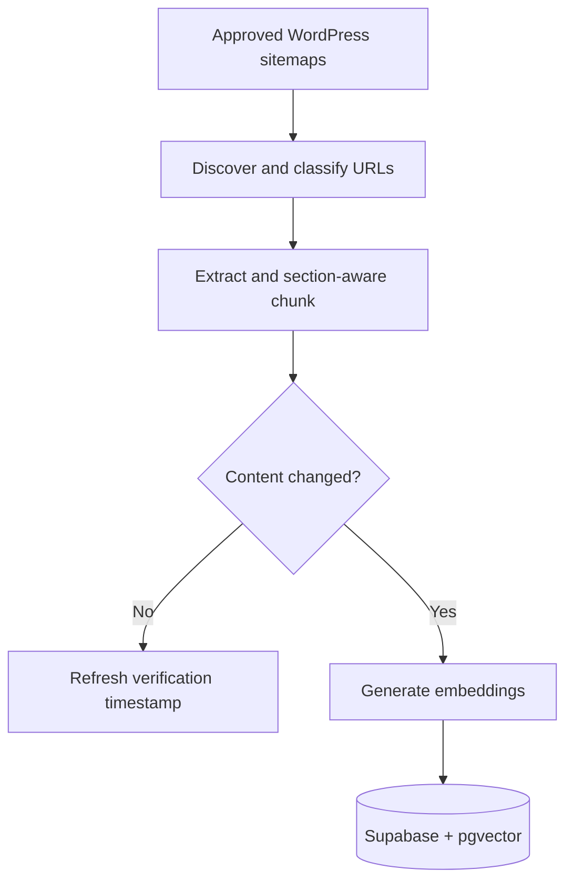
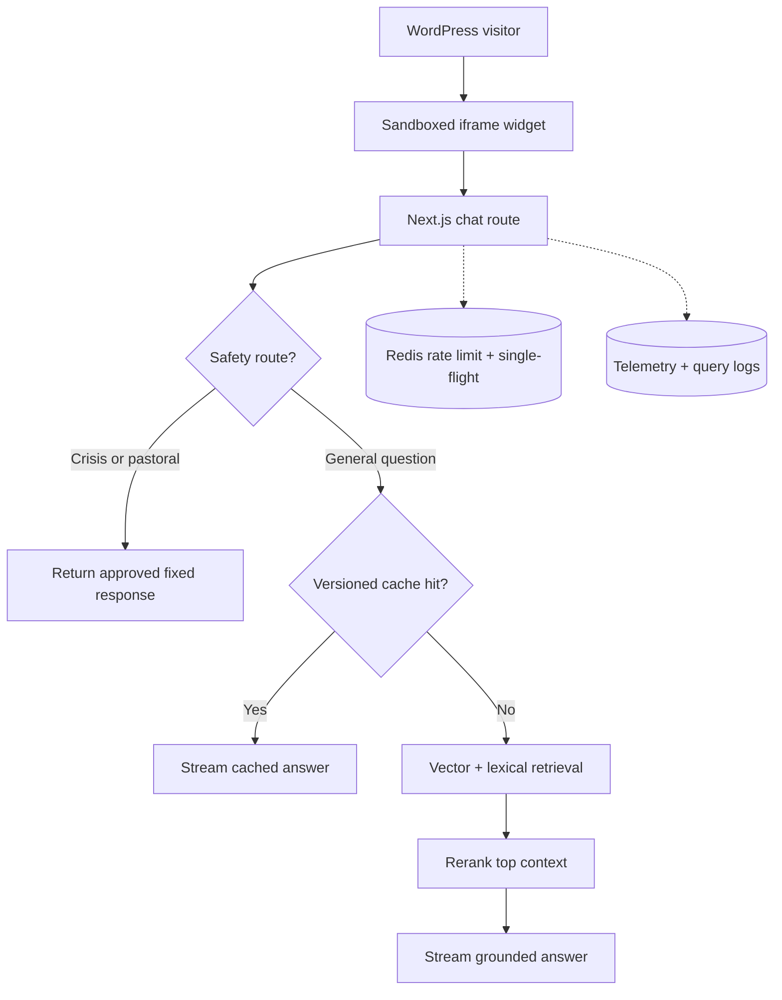

# WellChat

WellChat is a production retrieval-augmented assistant for [The Well Austin Community Church](https://thewellaustin.com/). It answers practical visitor questions from an approved content corpus, streams source-grounded responses, and routes sensitive requests to fixed human or emergency resources.

The system is deployed inside an existing WordPress site, but the retrieval, generation, safety, caching, and telemetry layers run in a separate Next.js application.

## At a glance

| | |
|---|---|
| **Problem** | Help church visitors quickly find accurate, trustworthy information without manually navigating the website.  |
| **Core system** | Incremental website ingestion → pgvector retrieval → lexical reranking → streamed GPT-4o mini response |
| **Production concerns** | Corpus freshness, cache invalidation, duplicate requests, rate limits, graceful degradation, privacy, and host-site isolation |
| **Stack** | Next.js, TypeScript, Supabase/Postgres + pgvector, OpenAI, Upstash Redis, Vercel |
| **Live deployment** | [thewellaustin.com](https://thewellaustin.com/) |

## Architecture

### Content indexing



### Visitor request



## Engineering decisions

### Treat content freshness as a data-engineering problem

The ingestion job discovers content only from approved sitemap families, assigns refresh cadences by content volatility, and uses deterministic cleaned-content hashes to avoid unnecessary embedding calls. Events and resource collections can be checked more frequently than stable pages such as beliefs.

Changed pages are inserted and validated before the previous chunks are removed. A transient fetch, embedding, or database failure therefore cannot erase the last known-good version. Sitemap orphans are retired only after a conclusive signal such as a `404`, `410`, redirect, `noindex`, or expired-event rule.

### Combine semantic recall with navigational precision

A visitor may ask semantically ("How can I get connected?") or use an exact site term ("sermons"). The online path therefore:

1. embeds the query with `text-embedding-3-small`;
2. retrieves a vector candidate set from pgvector;
3. adds lexical candidates for distinctive query terms;
4. merges the candidates and boosts matches in URL, title, section, and content;
5. prioritizes a directly named collection page;
6. sends only the highest-ranked chunks to the model.

The reranker is intentionally small and deterministic. It is easy to inspect, unit test, and tune against a hand-labeled retrieval set.

### Bound model behavior before generation

Crisis and explicit self-harm language bypass retrieval and generation. Pastoral or counseling requests are routed to staff rather than answered as spiritual advice. General questions fall back to approved contact resources when retrieval confidence is too low.

These rules are deliberately outside the prompt so the highest-risk paths do not depend on probabilistic compliance.

### Design for failure, duplication, and cost

- A Redis-backed fixed-window limiter is shared across serverless instances.
- A single-flight lock prevents concurrent copies of the same question from repeating embedding, retrieval, and generation work.
- Semantic answer-cache entries are tied to a corpus version and cleaned up after content changes.
- Missing Redis degrades cache and rate-limit behavior without taking down the core assistant.
- Retrieval or model failures return approved resources instead of fabricated answers.
- Logging and cache writes run after, or concurrently with, response completion where possible.

### Integrate without coupling to WordPress

WordPress loads a small script that mounts a CSP-restricted iframe. The host page never receives provider keys or retrieval logic, and the widget's CSS cannot interfere with the existing site. A narrow `postMessage` protocol handles resizing and validates the expected origin.

## Operations and evaluation

The protected `/admin` dashboard surfaces query volume, fallback and escalation rates, retrieval sources, cache activity, API errors, rate-limit events, and browser-measured time to first token and total response time.

The repository also includes three evaluation paths:

| Command | Scope |
|---|---|
| `npm run benchmark:retrieval` | Hand-labeled URL retrieval and reranking regression set |
| `npm run benchmark:rag` | Retrieval Precision/Recall, MRR, nDCG, faithfulness, relevance, citations, and groundedness |
| `npm run benchmark:rag:keyless` | Deployed-endpoint scoring with local open-source NLI and embedding models |
| `npm run benchmark:latency` | Streaming time-to-first-token versus full-response latency |

Benchmark outputs are environment- and corpus-dependent, so this README does not present a headline number without a committed run artifact. The harnesses and per-question outputs are the reproducible source of truth.

## Request lifecycle

For a normal visitor question:

1. Validate request shape and length, then apply the shared rate limit.
2. Classify safety-sensitive intent before retrieval.
3. Check a corpus-versioned semantic cache.
4. Embed the query and retrieve vector plus lexical candidates.
5. Rerank candidates and enforce the minimum similarity threshold.
6. Stream a context-only answer with source links.
7. Log the retrieval trace and final response.
8. Attach browser latency asynchronously through a correlated query ID.

## Run locally

### Prerequisites

- Node.js 20+
- Supabase project with pgvector enabled
- OpenAI API key
- Optional Upstash Redis instance for shared limiting, caching, and deduplication

### Setup

```bash
git clone https://github.com/gabriel-xiong/WellChat.git
cd WellChat
npm install
cp .env.example .env.local
```

Apply the SQL files in order:

1. `db/schema.sql`
2. `db/dashboard-migration.sql`
3. `db/scalability-migration.sql`

Configure at least:

```env
OPENAI_API_KEY=
NEXT_PUBLIC_SUPABASE_URL=
SUPABASE_SERVICE_ROLE_KEY=
BASE_SITE_URL=https://thewellaustin.com
ESCALATION_CONTACT=
```

Then ingest the approved corpus and start the app:

```bash
npm run ingest
npm run dev
```

Open [http://localhost:3000](http://localhost:3000).

Useful verification commands:

```bash
npm test
npm run lint
npm run build
npm run ingest:discover
npm run ingest:audit
```

## Repository map

```text
app/
  api/chat/route.ts             online RAG, safety, cache, streaming, and logging
  api/chat/telemetry/route.ts   browser latency correlation
  admin/page.tsx                protected operations dashboard
  widget/page.tsx               iframe-hosted production widget
components/
  ChatWidget.tsx                streaming visitor experience
  AdminDashboard.tsx            operational analytics
lib/
  retrieval.ts                  candidate merge and deterministic reranking
scripts/
  ingest.ts                     production incremental ingestion
  ingestion-core.ts             discovery, extraction, hashing, and chunking
  benchmark-*.ts                retrieval, RAG, and latency evaluation
db/
  schema.sql                    corpus, telemetry, and retrieval function
public/widget.js                host-site loader
wordpress/                      plugin and installation package
```

## Current limitations

- Safety routing uses explicit rules and requires continued red-team coverage.
- Retrieval evaluation is curated and small relative to the full range of visitor language.
- Managed model, database, and cache providers remain external dependencies.
- The admin view exposes sensitive visitor text to authorized operators; retention and access policies must be managed deliberately.
- Fixed-window limiting permits boundary bursts.
- End-to-end answer quality still needs periodic human review as the website corpus changes.

## Project context

WellChat was built as a production system rather than a standalone chatbot demo. The central engineering work is the lifecycle around the model: constrained content, safe refreshes, hybrid retrieval, deterministic routing, failure behavior, host integration, and observable operations.
